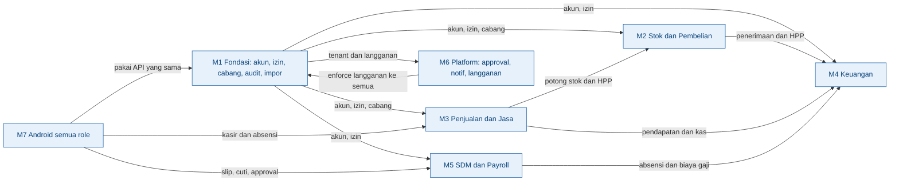
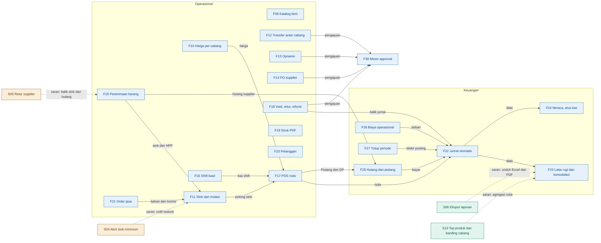
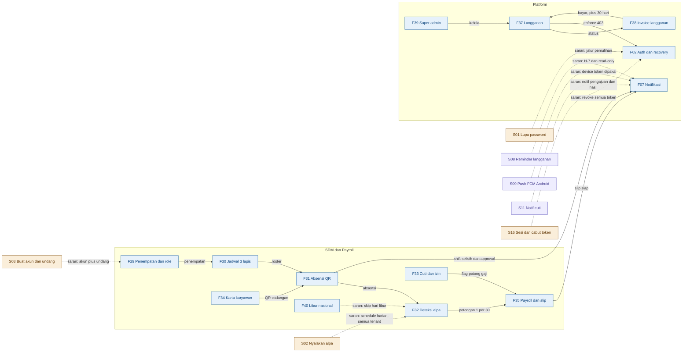

# Analisis Relasi Fitur: Aurevant PKK (Praluncur)

> Hasil review kelengkapan fitur sebelum launching. Sumber: `PROGRESS.md`, `doc/spek.md`,
> `doc/halaman.md`, `doc/menu-per-role.md`, `doc/android.md`, `server/routes/api.php`,
> `server/routes/console.php`, dan kode di `server/app` + `android/`.
> Tanggal analisis: 2026-10-18. Semua temuan di bawah dicek langsung ke kode, bukan asumsi.
>
> **Status tindak lanjut (2026-10-18 malam):** S01 ✅, S02 ✅, S03 ✅ (undangan email menyusul),
> S07 ✅ (email reset + reminder langganan; notifikasi cuti menyusul), S08 ✅, S09 ✅ (aktif
> setelah `google-services.json` di-drop ke `android/app/`). Sisa praluncur: kompilasi Android
> pertama + runbook deploy (§6). Tes server: 126 hijau.

## 1. Ringkasan

Aurevant PKK sudah sangat gemuk: 44 fitur lintas 7 modul, 190 route API, 40/40 halaman web,
aplikasi Android semua role, dan 114 tes server hijau. Relasi inti bisnis (kasir -> stok -> jurnal ->
laporan; PO -> penerimaan -> hutang; absensi -> payroll) sudah nyambung dan teruji.

Tapi ada 3 alur yang **putus secara diam-diam** dan berbahaya kalau launching sekarang —
**ketiganya sudah diperbaiki di commit tindak lanjut** (lihat status di atas):
(1) **deteksi alpa tidak pernah menyala** — command-nya ada tapi tidak terjadwal, wajib
`--company` satu-satu, dan tidak skip hari libur, padahal ini yang menggerakkan potongan gaji 1/30;
(2) **onboarding karyawan buntu** — satu-satunya jalur adalah impor CSV berpassword acak, sementara
lupa password tidak ada sama sekali; (3) **device token notifikasi buntu** — diproduksi tapi tidak
ada pengirim push-nya. Ditambah jalur langganan jatuh tempo yang tidak memberi kabar apa pun ke
pemilik sampai tulis tiba-tiba diblokir.

Saran terpenting: 5 perbaikan P1 (lupa password + kanal email, nyalakan alpa, buat akun karyawan,
reminder langganan, runbook deploy) sebelum menyentuh fitur baru apa pun.

## 2. Inventaris fitur

Status: `MVP` = sudah jalan, `MVP*` = ada tapi belum utuh, `Ditunda` = resmi di luar scope.

### M1 Fondasi & Tenancy

| ID | Fitur | Aktor | Data dipakai | Data dihasilkan | Status |
|----|-------|-------|--------------|-----------------|--------|
| F01 | Registrasi perusahaan + onboarding | Pemilik | data perusahaan | company, subscription trial | MVP |
| F02 | Login email/HP + pilih perusahaan + profil izin | Semua | kredensial | Sanctum token, daftar izin | MVP |
| F03 | RBAC role custom + 6 template subrole + scope | Pemilik | katalog izin | role, permission, assignment | MVP |
| F04 | Cabang + zona waktu WIB/WITA/WIT | Pemilik | data cabang | branch | MVP |
| F05 | Audit log append-only | Pemilik/auditor | aksi pengguna | audit_logs | MVP |
| F06 | Impor CSV + ekspor item/pelanggan | Pemilik | file CSV | items, stok, supplier, users | MVP |
| F07 | Notifikasi in-app + preferensi + device token | Semua | event domain | notifications, device_tokens | MVP (push aktif) |
| F08 | Dashboard per role | Semua | agregat semua modul | seksi dashboard | MVP |

### M2 Stok & Pembelian

| ID | Fitur | Aktor | Data dipakai | Data dihasilkan | Status |
|----|-------|-------|--------------|-----------------|--------|
| F09 | Katalog: kategori, item barang/jasa, supplier | Pemilik | data item | items, categories, suppliers | MVP |
| F10 | Harga per cabang (+ audit price.set) | Pemilik | harga | item_prices | MVP |
| F11 | Stok saldo + mutasi append-only + moving average | Gudang | movements | stock (HPP) | MVP |
| F12 | Transfer antar cabang (draft s/d diterima) | Gudang/Manajer | stok 2 cabang | transfer + in transit | MVP |
| F13 | Opname + selisih + penyesuaian | Gudang/Manajer | hitungan fisik | adjustment + approval | MVP |
| F14 | PO supplier (draft s/d selesai) | Gudang/Manajer | item, supplier | PO + approval | MVP |
| F15 | Penerimaan barang -> stok + HPP + hutang | Gudang/Keuangan | PO | movements, supplier_bill | MVP |

### M3 Penjualan & Jasa

| ID | Fitur | Aktor | Data dipakai | Data dihasilkan | Status |
|----|-------|-------|--------------|-----------------|--------|
| F16 | Shift kasir buka/tutup + selisih | Kasir | kas fisik | cash_shift + notif selisih | MVP |
| F17 | POS: nota campur, snapshot harga, split payment, DP, diskon, PPN, idempotency | Kasir | item, harga, stok, shift | sale + payments + jurnal | MVP |
| F18 | Void / retur / refund + approval | Kasir/Manajer | nota | sale_return + jurnal balik | MVP |
| F19 | Struk PDF (web server + lokal Android) | Kasir | nota | PDF struk | MVP |
| F20 | Pelanggan + ekspor CSV | Kasir/Manajer | data pelanggan | customers | MVP |
| F21 | Order jasa: proses, bahan terpotong, komisi, jadwal | Kasir/Pelaksana | item jasa, resep | order + komisi + movements | MVP |

### M4 Keuangan

| ID | Fitur | Aktor | Data dipakai | Data dihasilkan | Status |
|----|-------|-------|--------------|-----------------|--------|
| F22 | Jurnal otomatis semua modul | Sistem | event transaksi | journal_entries | MVP |
| F23 | Laba rugi cabang + konsolidasi + harian | Keuangan/Pemilik | jurnal | laporan | MVP |
| F24 | Neraca, arus kas, neraca saldo | Keuangan/Pemilik | jurnal | laporan | MVP |
| F25 | Hutang/piutang + aging + bayar parsial | Keuangan | tagihan/nota | pembayaran | MVP |
| F26 | Biaya operasional + kategori + approval | Keuangan | pengeluaran | expense + jurnal | MVP |
| F27 | Tutup/buka periode (blokir posting) | Keuangan | status periode | accounting_period | MVP |
| F28 | BPJS + PPh 21 annualisasi + PTKP | Keuangan/HR | komponen gaji | potongan pajak | MVP |

### M5 SDM & Payroll

| ID | Fitur | Aktor | Data dipakai | Data dihasilkan | Status |
|----|-------|-------|--------------|-----------------|--------|
| F29 | Penempatan karyawan + riwayat + beri/cabut role | HR/Pemilik | data karyawan | assignment | MVP |
| F30 | Jadwal 3 lapis: master shift, pola, override | HR | shift | roster | MVP |
| F31 | Absensi QR dinamis + geofence + selfie + 1 akun 1 HP + cadangan kartu+PIN | Semua | QR, GPS, foto | attendance | MVP |
| F32 | Deteksi alpa otomatis | Sistem | roster, absensi | status alpa | MVP (terjadwal 00:30) |
| F33 | Cuti/izin/sakit + keputusan + flag potong gaji | Semua/HR | pengajuan | leave + status | MVP |
| F34 | Kartu karyawan PDF/PNG + QR | Semua/HR | profil | kartu | MVP |
| F35 | Penggajian: komponen fleksibel, periode, slip PDF, komisi dari order jasa | HR/Keuangan | absensi, komisi, komponen | payroll + slip + biaya | MVP |

### M6 Platform

| ID | Fitur | Aktor | Data dipakai | Data dihasilkan | Status |
|----|-------|-------|--------------|-----------------|--------|
| F36 | Mesin approval tunggal (void, diskon, refund, PO, transfer, opname) | Semua/approver | pengajuan | approval + eksekusi | MVP |
| F37 | Langganan: paket + siklus trial/aktif/tenggang/read-only/suspend | Super admin | paket | subscription + enforce 403 | MVP |
| F38 | Invoice langganan otomatis harian + bayar +30 hari | Super admin/Sistem | subscription | invoice | MVP |
| F39 | Super admin: paket, kelola langganan, invoice, libur nasional | Super admin | platform | plans, holiday | MVP |
| F40 | Libur nasional/perusahaan | Sistem | kalender | holidays | MVP |

### M7 Android

| ID | Fitur | Aktor | Data dipakai | Data dihasilkan | Status |
|----|-------|-------|--------------|-----------------|--------|
| F41 | Login + pilih perusahaan | Semua | kredensial | token | MVP (belum pernah dikompilasi) |
| F42 | Absensi QR + kartu + cuti + slip | Karyawan | kamera, GPS | attendance, pengajuan | MVP (idem) |
| F43 | Kasir + shift + struk PDF lokal | Kasir | item, harga | sale | MVP (idem) |
| F44 | Persetujuan + notifikasi polling | Manajer/HR | approval, notif | keputusan | MVP (idem) |

## 3. Diagram relasi

### 3.1 Peta modul (gambaran besar)

Biru = modul yang sudah ada; garis solid = relasi yang sudah berjalan. Android (M7) adalah
cermin API dari modul web yang sama, jadi tidak digambar lengkap di sini.

### 3.2 Inti penjualan -> stok -> keuangan (dengan saran)

Biru = sudah ada, hijau = saran lanjutan, oranye = saran pelengkap, garis putus-putus = saran relasi.

### 3.3 SDM, langganan, dan notifikasi (dengan saran)

## 4. Temuan

### 4.1 Alur putus: absensi -> gaji tidak pernah jalan otomatis (P1, paling kritis)

Rantai `F32 (alpa) -> F35 (potong 1/30)` putus karena tiga hal sekaligus:

- `server/routes/console.php:11` hanya menjadwalkan `billing:generate`. Perintah
  `attendance:mark-absent` tidak pernah dijadwalkan.
- `MarkAbsent.php:13` mewajibkan `--company` satu-satu; dijalankan tanpa opsi -> error
  "Company tidak ditemukan" (`MarkAbsent.php:21-23`). Tidak ada versi "semua tenant".
- `Application/Attendance` tidak menyentuh tabel `holidays` sama sekali, padahal libur nasional
  dan libur perusahaan (F40) sudah ada. Kalau dijalankan untuk tanggal libur, karyawan bisa
  ditandai alpa palsu -> gaji dipotong salah.

Efek: fitur "Deteksi alpa otomatis" yang sudah dicentang di `PROGRESS.md:46` sebenarnya mati.
Potongan alpa hanya terjadi kalau ada yang menjalankan command manual per perusahaan.

### 4.2 Alur putus: onboarding karyawan buntu (P1)

- Tidak ada endpoint buat/undang user. Satu-satunya jalur masuk karyawan adalah impor CSV (F06)
  atau seeder.
- `ImportFile.php:283-289`: kalau kolom `password` kosong, sistem membuat password acak
  `Str::random(16)` yang tidak pernah diberitahukan ke siapa pun.
- Lupa password tidak ada: nol endpoint reset di `routes/api.php`, nol UI di `client/src`.

Kombinasi ketiganya: karyawan hasil impor praktis tidak bisa login selamanya.

### 4.3 Data buntu: device token tanpa pengirim (P2)

`POST /device-tokens` menerima token, `NotificationTypes` + preferensi jalan, tapi:
tidak ada kode FCM/push di `server/app` maupun `android/` (grep "firebase|fcm|push" = 0 hasil).
Android (F44) memantau notifikasi via polling saja. Kolom `device_tokens` diproduksi tapi tidak
ada yang memakainya.

### 4.4 Jembatan hilang: langganan jatuh tempo tanpa kabar (P1 untuk launch publik)

`F37/F38` (langganan + invoice) tidak pernah memberi notifikasi ke Pemilik: tidak ada reminder
H-7, tidak ada pemberitahuan masuk tenggang/read-only. Bukti: tidak ada `Notifier` di alur
subscription; satu-satunya kabar adalah 403 "Perusahaan atau langganan tidak aktif." saat menulis.
Juga tidak ada halaman/instruksi "cara bayar" untuk tenant (transfer manual + konfirmasi super admin).

### 4.5 Jembatan hilang: cuti tanpa notifikasi (P2)

`Application/Leave` tidak memanggil `Notifier` sama sekali: HR tidak dapat notifikasi saat ada
pengajuan cuti, karyawan tidak dapat notifikasi saat diputuskan. Jawaban: halaman Cuti Saya +
seksi dashboard SDM (F08), tapi tanpa kabar.

### 4.6 Siklus satu arah: tidak ada retur supplier (P2)

`F15 (penerimaan) -> F25 (hutang)` jalan, tapi barang salah/kualitas buruk tidak bisa
dikembalikan: tidak ada retur supplier -> stok tidak bisa turun, hutang tidak bisa dikoreksi.

### 4.7 Celah lensa stok: tidak ada ambang minimum (P2)

Tidak ada field `min_stock` di migrasi item dan tidak ada alert. "Alert stok minimum ditunda"
dicatat di `PROGRESS.md` — tapi tanpa field-nya di skema, fitur lanjutannya nanti lebih mahal.

### 4.8 Celah peran: mode "lihat sebagai" super admin tidak dibangun (P3)

`doc/spek.md` menjanjikan super admin bisa "lihat sebagai" dengan izin + audit. Di
`doc/halaman.md` §10 tidak ada halaman itu. Keputusan: hapus dari spek atau tunda resmi (jangan
biarkan spek dan kenyataan berbeda).

### 4.9 Hub yang perlu dijaga

`F17 (POS)` adalah hub terbesar: bergantung pada F9, F10, F11, F16, F20, F36, F38 dan menulis ke
F22, F25. Ini wajar dan sudah ditutup 114 tes — catat saja sebagai area paling rawan regresi.

### 4.10 Tumpang tindih: tidak ada

Web dan Android memang mencerminkan fitur yang sama (memang desainnya), bukan duplikasi logika —
keduanya memakai API yang sama.

## 5. Saran fitur

### Lanjutan

| Nama saran | Kenapa (bukti) | Nyambung ke | Effort | Prioritas | Fase |
|---|---|---|---|---|---|
| S06 Ekspor laporan (Excel/PDF) | Semua laporan (F23-F25) hanya bisa dilihat; Pemilik tidak bisa mengarsipkan/membagikan. Satu-satunya ekspor hanya item + pelanggan (`api.php:128-129`) | F23, F24 | M | P2 | v2 |
| S13 Top produk + perbandingan antar cabang | Ada di brainstorm awal `spek.md` ("top produk, performa karyawan"); data sudah lengkap di sale_lines + branches | F23, F08 | M | P2 | v2 |
| S10 Cetak thermal ESC/POS Bluetooth | Kasir lapangan butuh struk kertas; sekarang web PDF + Android lokal saja (F19). Sudah dicatat "menyusul" di PROGRESS | F19, F43 | M | P2 | v2 |
| S15 Agenda booking order jasa | `scheduled_at` sudah ada di DB + divalidasi (`ServiceOrderController.php:48`); tinggal pastikan tampilan agenda per pelaksana (F21 + F30) | F21, F30 | S | P3 | nanti |

### Pelengkap

| Nama saran | Kenapa (bukti) | Nyambung ke | Effort | Prioritas | Fase |
|---|---|---|---|---|---|
| S01 Lupa password + ganti password ✅ | Nol endpoint reset; korban pertama adalah hasil impor (password acak, `ImportFile.php:289`). Wajib sebelum ada user nyata | F02 | M | P1 | praluncur |
| S02 Nyalakan + benahi deteksi alpa ✅ | 3 bukti di temuan 4.1; ini penggerak potongan gaji otomatis. Perbaikan: iterasi semua company, jadwalkan harian 00:30, skip F40 | F32, F35, F40 | S | P1 | praluncur |
| S03 Buat akun karyawan + undang ✅ | Hanya impor CSV; tidak ada POST users. Butuh: buat akun + bagikan kredensial awal + paksa ganti password | F29, F03 | M | P1 | MVP |
| S04 Alert stok minimum | Tidak ada field `min_stock` sama sekali; "alert ditunda" tapi fieldnya belum ada -> cicil sekarang (field + cek saat keluar) | F11, F07 | M | P2 | v2 |
| S05 Retur supplier | Menutup siklus F14/F15: stok turun + hutang terkoreksi (temuan 4.6) | F15, F25 | M | P2 | v2 |
| S16 Daftar sesi & cabut token | Sanctum token tidak pernah kedaluwarsa; tidak ada logout-all. Nanti nyambung ke S01 (ganti password -> revoke) | F02 | S | P2 | v2 |

### Penghubung

| Nama saran | Kenapa (bukti) | Nyambung ke | Effort | Prioritas | Fase |
|---|---|---|---|---|---|
| S07 Kanal email dasar ✅ | Paket wajib: dipakai S01 (reset), S08 (reminder), S11 (cuti). Laravel mail tinggal konfigurasi + queued job | F02, F07, F37 | M | P1 | praluncur |
| S08 Reminder langganan ke Pemilik ✅ | Bukti temuan 4.4: read-only menyerang tanpa kabar. Invoice harian sudah ada, tinggal notif in-app + email | F37, F38, F07 | S | P1 | MVP |
| S09 Push Android via FCM ✅ | Menutup temuan 4.3: device token jadi berguna; Android tidak perlu polling terus | F07, F44 | M | P2 | v2 |
| S11 Notifikasi cuti 2 arah | Menutup temuan 4.5: pengajuan -> HR, keputusan -> karyawan | F33, F07 | S | P2 | v2 |

### Jangan ditambah dulu

- **Loyalty/poin** — sudah resmi ditunda; tidak menguatkan satu pun alur yang ada.
- **Payment gateway/QRIS** — pembayaran dicatat manual by design (`spek.md`); tambah setelah S08 terbukti.
- **Mode offline kasir** — mahal (disebut sendiri di `spek.md`); tunda.
- **Login pelanggan** — sudah diputuskan tidak (pertanyaan 9 di spek).
- **2FA** — bagus tapi bukan celah praluncur; S16 + S01 dulu.
- **"Lihat sebagai" super admin** — putuskan: hapus dari spek atau tunda resmi (temuan 4.8).

## 6. Wajib sebelum launch (operasional, bukan fitur)

1. **Kompilasi Android pertama kali.** Kode Android belum pernah di-build (`assembleDebug`).
   Review statis sudah menemukan 34 error; asumsikan masih ada sisa. Ini blocker rilis mobile.
2. **Runbook deploy:** HTTPS + `APP_DEBUG=false` + CORS origin web + `storage:link` (selfie
   absensi!) + `queue:work` (audit + notif) + cron `schedule:run` (billing harian + S02 nanti) +
   backup MySQL harian + rotasi log.
3. **Kredensial produksi:** SMTP (untuk S07), ganti/hapus akun demo seeder, periksa `APP_KEY`.
4. **Smoke test 10 alur inti** dengan data bersih: register -> cabang -> katalog -> harga -> POS ->
   shift -> void/refund -> PO -> terima -> tutup buku.
5. **Policy token:** putuskan masa berlaku Sanctum + revoke saat ganti password (nyambung S16).

## 7. Urutan eksekusi

1. **P0 praluncur:** kompilasi + smoke test Android; susun runbook deploy (cron, worker, backup, storage).
2. **P1 auth:** S07 kanal email -> S01 lupa/ganti password -> S16 cabut semua token. ✅ (S16: sesi lain dicabut saat ganti password; logout-all terpisah menyusul)
3. **P1 rantai gaji:** S02 nyalakan alpa (semua tenant + skip libur) — murah, berdampak besar. ✅
4. **P1 onboarding:** S03 buat akun + undang karyawan (paksa ganti password — bergantung S01). ✅ (undangan email menyusul)
5. **P1 SaaS:** S08 reminder langganan (in-app + email). ✅
6. **v2 batch:** S04, S05, S06, S13, S09 ✅, S10, S11, S15.

## 8. Pertanyaan terbuka

1. Launch-nya untuk perusahaan nyata dengan kasir lapangan, atau demo/tugas sekolah dulu?
   -> menentukan prioritas S09 (push) dan S10 (printer thermal).
2. Bayar langganan tetap transfer manual + konfirmasi super admin? -> menentukan detail S08.
3. Karyawan akan didaftarkan lewat UI (butuh S03) atau cukup CSV? -> kalau cukup CSV, S01 tetap
   wajib karena password impor acak.
